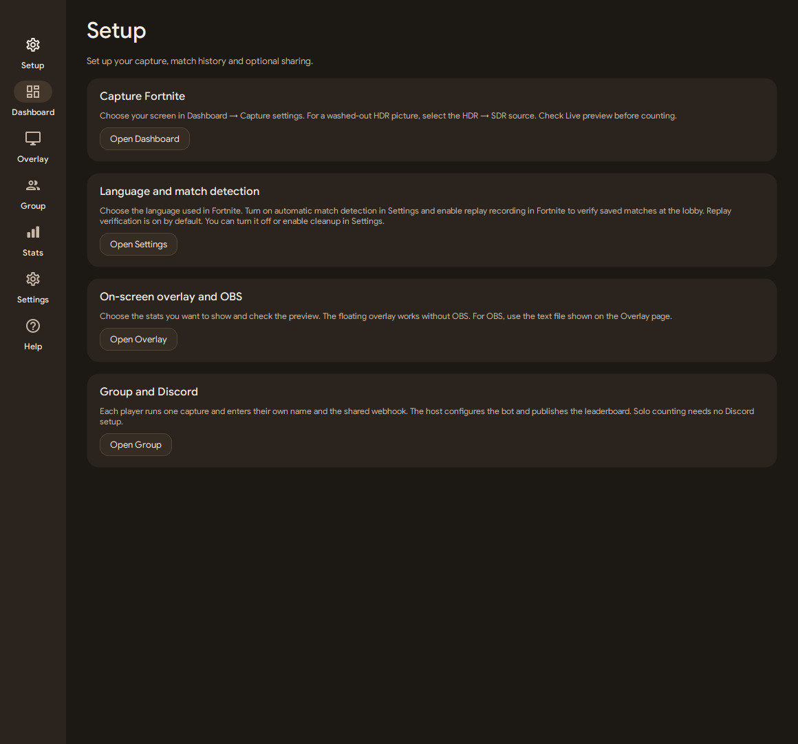
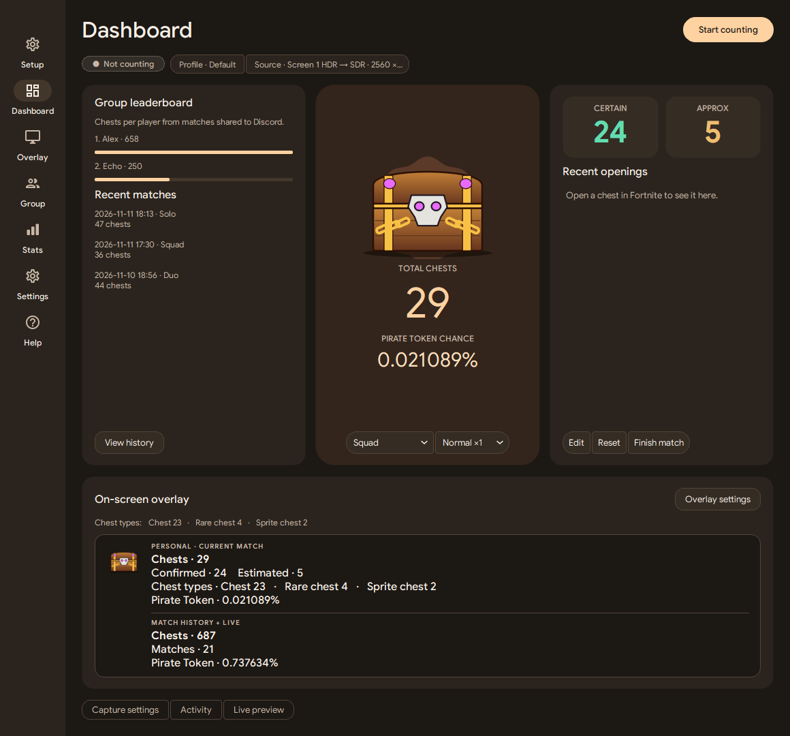
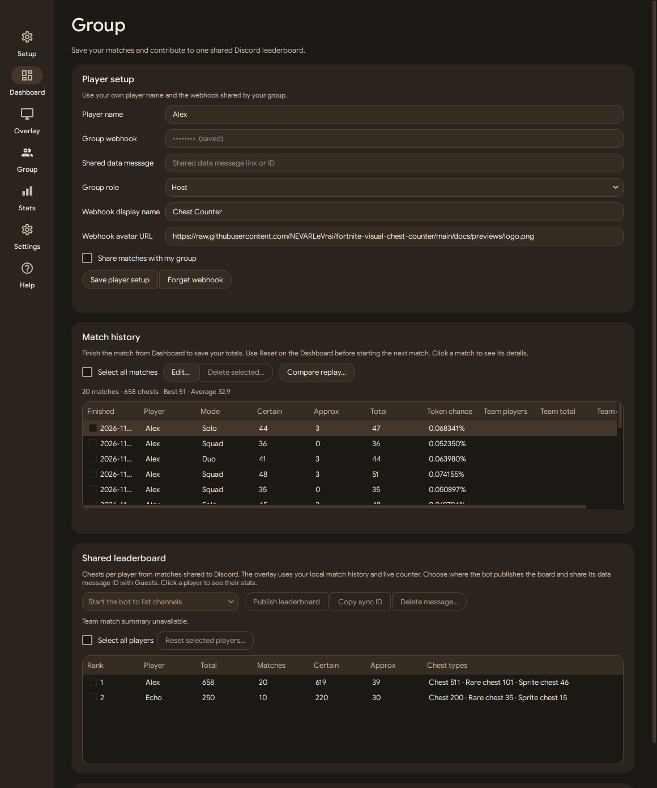
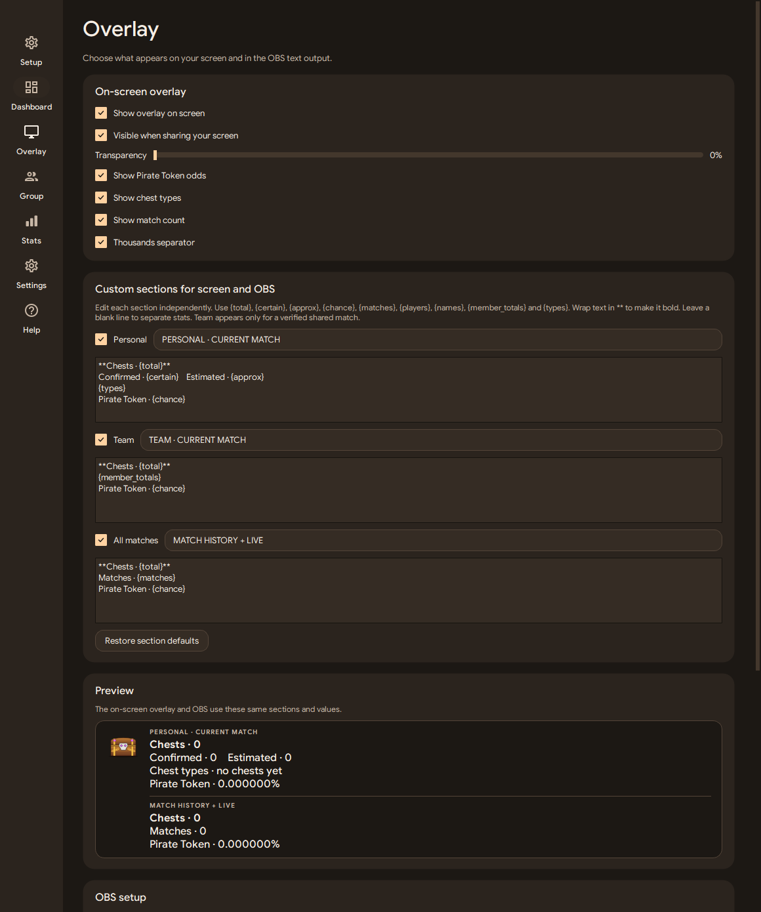
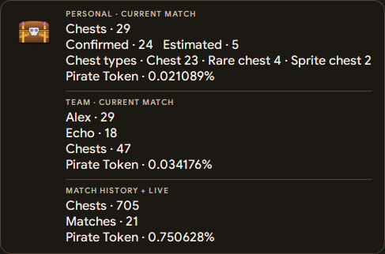
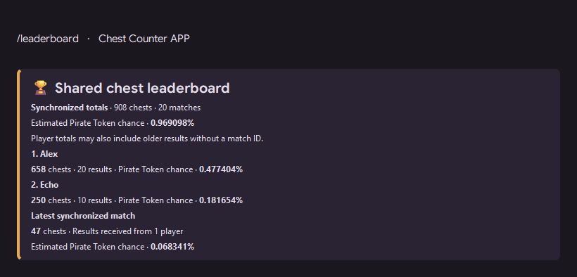
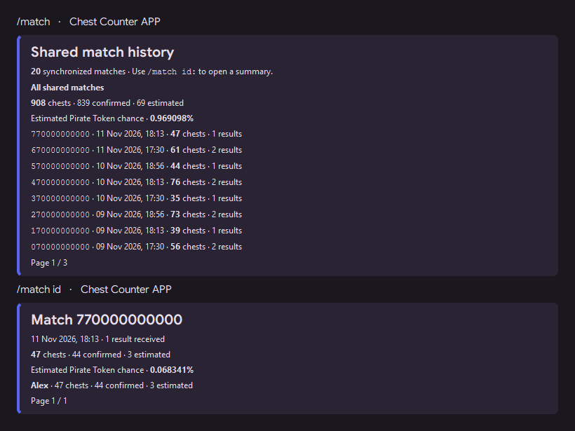

  
  
Count your chests, follow the squad and keep the stats for every match.

  

    
    
    
    
    
    
    
  

  
<a href="#get-started"><b>Get started</b></a> · <a href="#features">Features</a> · <a href="#previews">Previews</a> · <a href="docs/guides/matches-and-discord.md">Discord setup</a> · <a href="docs/index.md">Documentation</a>

A portable Windows app that reads Fortnite's chest-opening pop-ups from gameplay video. Use a screen, livestream, OBS feed, capture card or recording, then show the results on screen and share them with your group.

Current fork release **v0.3.1 stable**. [Download for Windows](https://github.com/NEVARLeVrai/fortnite-visual-chest-counter/releases/tag/v0.3.1) or see the [release notes](docs/releases/RELEASE_NOTES_v0.3.1.md).

## Get started

1. Get the [portable build](https://github.com/NEVARLeVrai/fortnite-visual-chest-counter/releases/tag/v0.3.1), or follow the [development guide](docs/DEVELOPMENT.md) to run this branch. Extract the whole ZIP and launch **Fortnite Visual Chest Counter.exe**. Portable builds include Python and the video tools.
2. Open the app from its **Windows system tray** icon. In **Dashboard → Capture settings**, choose one capture source. The default is **Screen 1 HDR → SDR**. Use the regular Screen entry for an SDR monitor.
3. In **Settings → Fortnite language**, select the HUD language. English, French and Brazilian Portuguese are supported, with a combined English/Portuguese option.
4. Keep the gameplay fullscreen in 16:9 with the HUD visible. Click **Start counting**, or let **Match automation** reset and start the next local Battle Royale match at warmup.
5. Choose **Auto** for the mode or select Solo, Duo, Trio or Squad manually. Set the Pirate Token boost to match the rate you want to estimate.

The tray menu opens the window or quits the app. Closing the window can keep counting in the tray. These behaviours are configurable in Settings.

Open **Setup** above Dashboard for shortcuts to capture, match detection, overlay and Group configuration.

When updating an existing installation, close the app, extract the whole ZIP into a new folder and copy your own `config.toml` and `state/` into it. Discord credentials remain available on the same Windows account. Install the first fork release from its ZIP to establish trust in the fork’s signing keys. Later compatible signed releases can update through the app. For optional replay verification, see the [Windows runtime requirements](docs/guides/matches-and-discord.md#automatic-replay-verification).

## Features

### Your counter, live

**Certain** is the number of confirmed openings. **Approx** contains additional estimated openings. **Total** adds them together. For example, 42 confirmed and 9 estimated gives a total of 51.

- Detect normal, Rare and Sprite chests, with an unknown type when the pop-up cannot be classified reliably.
- Follow recent openings, detector decisions and a live preview. Select 5, 10 or 15 analysed frames per second.
- Keep separate counts, capture settings and chest-type breakdowns with profiles. Edit the confirmed and estimated counts or reset the current match.
- Analyse a recorded video separately from the live counter.
- Use one capture per app. Each teammate runs their own capture and shares their results through the group feed.

### Match history and squad stats

- [Verify matches with Fortnite replays](docs/guides/matches-and-discord.md#automatic-replay-verification) and optionally remove verified local replays.

- Save manually with **Finish match**, or use Fortnite's local log to finish automatically. The final count stays visible in the lobby and resets when the next Battle Royale match starts.
- Detect the Battle Royale mode from the log or choose it manually. Automatic mode detection also works with manual start and finish.
- Edit saved counts, tick individual matches or select all for batch deletion.
- See verified teammates, team chest totals and team odds alongside your personal result. Team membership comes from matching session fingerprints and received player submissions.
- Share current match totals while playing. The app coalesces updates before sending them, retries delivery and treats the saved result as the final count.

### Three views in the overlay

| Scope | What it includes |
|---|---|
| **Personal** | Your current match, with confirmed, estimated and total openings. |
| **Team** | Submitted openings from players in the same verified session. It appears when a teammate has contributed. |
| **All matches** | Your saved matches and the current counter, with their match count and each matching shared session counted once. |

The chest illustration changes with the detected type. Give each Personal, Team and All matches section its own heading and multiline template, including cumulative match count. Configure transparency and screen-share visibility, then preview the same overlay in the app. Each section starts with its chest total. Team member counts follow the team total. Wrap any text or placeholder in `**` for bold in the on-screen overlay and add blank lines to space out the statistics. You can also display token odds, chest types and your saved match count.

OBS can read `obs_output\chest_counter.txt` with **Text (GDI+)**, or receive direct updates through OBS WebSocket. The app writes the same enabled custom sections to that file and the floating overlay. Separate legacy CLI output files retain their original count conventions. See the [overlay guide](docs/guides/obs-overlay.md).

### Pirate Token estimates

The app estimates the probability of at least one drop using the submitted chest count and selected boost. For `n` chests at a per-chest probability `p`, the calculation is `1 − (1 − p)^n`. The base model uses 1 in 137,500 per chest.

Cumulative odds keep each match's boost. For mixed rates, the calculation is `1 − ∏(1 − pᵢ)ⁿᵢ`. A solo match contributes your own openings. A verified shared match contributes its team openings once. Percentages are calculated from those rolls instead of added together. [Fortnite Status](https://x.com/FortniteStatus/status/2119202610322227327) · [Independent calculator](https://piratetoken.quest/drop-rate/)

### Group and Discord

One person runs the **Host** bot. Other players use **Guest**, their own name and the shared webhook. The Host publishes a board and shares the **sync ID** so the other apps can read the same data.

- Show the ranking in the Dashboard and Group page, with totals, confidence, chest types and saved match counts where available.
- Choose the public leaderboard's destination from the online bot's available Discord channels. Publish it from the app or from a Discord command.
- Browse shared history with `/match`, choose a match ID for its summary, and use `/chests` for player breakdowns.
- Send match summaries manually or automatically after saving. Start or stop the bot and choose whether it starts with the app.
- Give the bot a name, local avatar and banner, and configure the webhook sender name and avatar URL separately. Customise its Discord activity text, type and rotation interval for team totals, token odds and saved group stats.
- Reset selected players in the standings or remove the published board. Local match history is managed separately.
- Turn off **Share matches with my group** to keep new matches local and restore personal mode and boost controls.

| Command | Action |
|---|---|
| `/chests` | Show shared totals or a player's counts and cumulative Pirate Token estimate. |
| `/leaderboard` | Show the synchronized total, player rankings and the latest synchronized match. |
| `/match` | Browse shared match history or open a specific match by ID. |
| `/leaderboard publish:true` | Publish or move the auto-updating board to the current channel. Requires Manage Server. |
| `/add` | Correct a player's total. Requires Manage Server. |
| `/reset` | Reset a player's standing. Requires Manage Server. |

The synchronized total at the top of the board matches `/match`: one result per player and match ID. Player rankings can also include older results without a match ID and administrator adjustments. The webhook receives submissions in its feed channel. The public bot leaderboard can live in another channel. See [setup, permissions and sharing](docs/guides/matches-and-discord.md).

### Windows tools and diagnostics

- Start in the tray, keep counting when the window closes and remember window position.
- Restore the Settings page's defaults with **Reset all**.
- Record logs, popup snapshots and diagnostic clips. Press **Ctrl+Alt+M** to mark a missed chest and replay it with **Review captures**.
- Run and copy a diagnostic report or clean generated logs and captures when counting is stopped.
- Check for packaged updates and configure the download limit. See [the updater guide](docs/maintenance/UPDATER.md).

## Previews

<table>
<tr><td></td></tr>
<tr><td align="center">Setup guide for capture, matches, overlay and Discord</td></tr>
</table>

The screenshots show the application with sample data.

<table>
<tr><td></td></tr>
<tr><td align="center">Dashboard — personal counts, verified team stats and cumulative match totals.</td></tr>
</table>

<table>
  <tr>
    <td width="50%"></td>
    <td width="50%"></td>
  </tr>
  <tr><td align="center">Match history and Group</td><td align="center">Overlay settings</td></tr>
</table>

<table>
<tr><td align="center"></td></tr>
<tr><td align="center">Overlay — Personal, Team and All matches sections with custom text and token estimates.</td></tr>
</table>

### Discord previews

These images are local simulations using sample values and the bot's embed data.

<table>
  <tr>
    <td width="58%"></td>
    <td width="42%"></td>
  </tr>
  <tr><td align="center">Simulated leaderboard embed</td><td align="center">Simulated bot profile and presence</td></tr>
</table>

<table>
<tr><td></td></tr>
<tr><td align="center">Shared match history and a selected match summary</td></tr>
</table>

## Capture setups

| Gameplay source | Guide |
|---|---|
| A game, stream or video on a monitor | [Screen capture, including HDR](docs/guides/screen-capture.md) |
| Twitch or YouTube live URL | [Livestream capture](docs/guides/livestream-url.md) |
| OBS and Fortnite on one PC | [OBS Virtual Camera](docs/guides/obs-single-pc.md) |
| Two PCs on the same network | [OBS over SRT](docs/guides/obs-dual-pc-srt.md) |
| OBS when Virtual Camera is already in use | [OBS projector](docs/guides/obs-projector.md) |
| A console or second PC through a capture device | [Capture card](docs/guides/capture-card.md) |
| A saved gameplay file | [Recorded video](docs/guides/recorded-video.md) |

## Compatibility and data

HUD size, compression, occlusion and fast consecutive openings can affect the count. Chest-type detection has been exercised on English and French footage. Unsupported playlists and matches already underway may require manual tracking. See [troubleshooting](docs/guides/troubleshooting.md) and [validation notes](docs/CHANGES.md).

Counting reads video frames. Optional match features read the local Fortnite log. Discord sharing sends player stats and a session fingerprint. Diagnostics are saved locally when enabled. The project is independent and has no Epic Games approval.

## Development

Use an editable Python installation or `debug-chest-counter.bat` from a configured checkout. The [development guide](docs/DEVELOPMENT.md) covers tests and Windows packaging. The [documentation index](docs/index.md) links to guides, research, releases and maintenance notes.

Upstream commits credit Claude Opus 5.5 as a co-author. This branch uses Codex-assisted development, including GPT-6.1 Sol at medium reasoning effort. Detector changes should be checked against independent gameplay recordings. Discord integration tests use simulated responses; a live Host/Guest check is part of release validation.

## Acknowledgements and license

[Fortnite Visual Chest Counter](https://github.com/GabrielGzS/fortnite-visual-chest-counter) by Gabriel Gomez provides the foundation. The animated chest is adapted from [Chest Tracker](https://github.com/Xxoris190/chest-tracker), with its MIT attribution retained. The presentation takes cues from Chest Tracker and [N-Zik's README](https://github.com/N-Zik-Group/N-Zik#readme).

**[MIT License](LICENSE)** · **[Acknowledgements](docs/ACKNOWLEDGEMENTS.md)** · **[Distribution notices](packaging/LICENSE-NOTICE.txt)**

Google Sans uses the SIL Open Font License 1.1, and Material Icons use Apache-2.0. The portable runtime retains the Python, Qt, FFmpeg, NumPy, SciPy and Discord dependency notices. Fortnite is a trademark of Epic Games, Inc.
