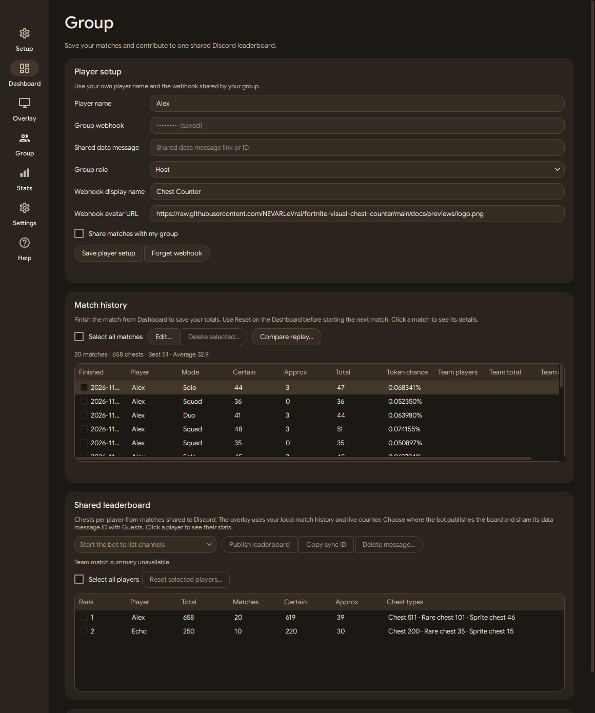
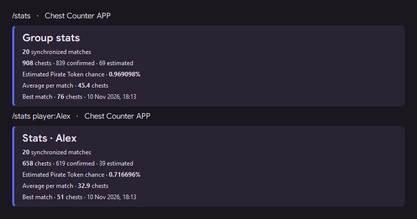
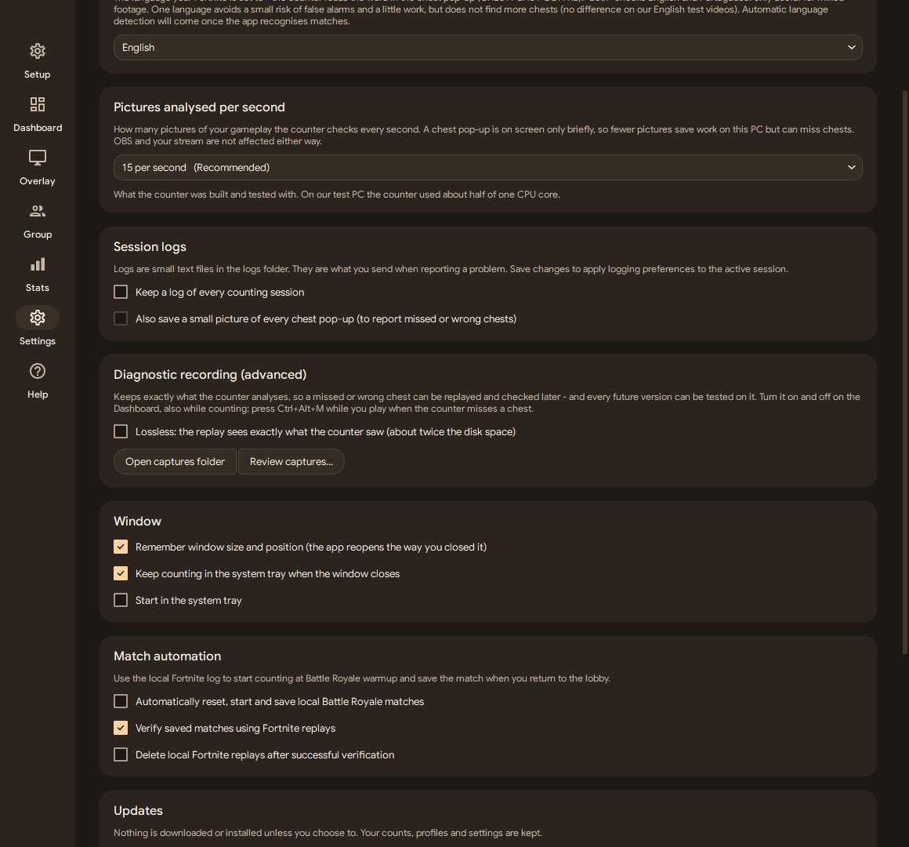

# Matches and Discord

## Your local match

Choose one source in **Dashboard → Capture settings**. To track manually, reset before the match, start counting and use **Finish match** to save it. **Group → Match history** opens match details when you click a data cell. You can also edit saved counts and delete checked rows. **Select all matches** checks every row. Local edits and deletions affect the history on your PC. Already shared results stay in the shared standings.

**Settings → Match automation** is enabled by default. It reads new entries in `%LOCALAPPDATA%\FortniteGame\Saved\Logs\FortniteGame.log`. Battle Royale warmup resets and starts the count. A return to the lobby stops counting and saves the result to match history. The final live count stays visible until the next Battle Royale warmup resets it. For a match already underway when the app opened, use the manual controls.

The Dashboard mode selector defaults to **Auto**. It reads the Battle Royale playlist from the same log, including Ranked playlists that use Fortnite’s Habanero naming, independently of automatic start and finish. You can select **Solo**, **Duo**, **Trio** or **Squad** manually. The Pirate Token multiplier is manual. Unrecognised playlists may need manual mode selection.

## Share with teammates

1. Each player runs their own app and capture. In **Group → Player setup**, save a distinct player name and the same **Group webhook**. The URL identifies the collection channel. Share it privately.
2. Choose **Host** on the PC running the bot and **Guest** on the other PCs. Enable **Share matches with my group** on the PCs that should contribute.
3. The Host starts the bot, chooses a **Leaderboard channel** and clicks **Publish leaderboard**. The dropdown lists text channels where the bot can view the channel, send messages and embed links.
4. The Host uses **Copy sync ID**. Guests save that value under **Shared data message**. This feed message lets Guests read the same group data without receiving the bot token.

The leaderboard ranks each player by the chests in their published results. Click a player name to open their stats. The public board and `/chests` show a cumulative Pirate Token estimate from each player’s shared chests, using the saved boosts. The board starts with the same synchronized total and odds as `/match`, then shows the player ranking and the latest synchronized match. Linked results count once per player and match ID. The player ranking also includes older unlinked reports and honors administrator adjustments and resets. The synchronized total reflects the full linked history. Use `/chests` for chest types and the confirmed/estimated breakdown. **Match history + live** in the overlay uses your local match history, linked teammate counts and the current counter.

The collection webhook and the public leaderboard have separate jobs. Submissions go to the webhook's feed channel. The bot can publish the visible board in a different channel. Publishing again in another channel moves the tracked board there. A channel permission failure leaves the previous publication available for retry.

Guests with sharing enabled follow the Host's published mode and boost. Turning sharing off keeps new matches local and restores the Guest's personal controls. A Guest can read the last published data when the bot is offline. New contributions need the bot online before they appear in the shared data.

## Live sessions and history

Live team totals refresh while counting or while the floating overlay is visible, including when a Guest uses another page. The Host can still show team updates already received during a temporary Discord publication cooldown. If you open the app mid-match, start counting with an empty counter and match automation enabled. A recent, identified local warmup can link the capture to that match. The Team overlay shows when each teammate last updated their count, or that their result is finished. During capture, it also shows why it is waiting when a match ID or teammate update is missing.

Live sharing applies to a local Battle Royale match with a verified session fingerprint. The app queues the latest counts every five to eight seconds, with a per-client stagger and small random variation so players do not all send together. It coalesces unsent changes and updates the same live webhook message. A saved match supplies the final result. Retries update that player's result instead of adding the same chests again. Webhook submissions and shared-board requests share a cooldown: Discord’s `Retry-After` / `retry_after` and exhausted-bucket reset delays are respected. Pending results stay queued during the pause; the app does not block the UI or loop on HTTP 429. The bot’s authenticated requests also use discord.py’s rate-limit handling. See [Discord’s rate-limit documentation](https://docs.discord.com/developers/topics/rate-limits).

Matching Fortnite session fingerprints group teammates even when they leave at different times. The app sends the fingerprint, player name, confidence counts and boost, rather than the raw Fortnite log. Team membership is based on received submissions from that session. Players in another match stay in their own session.

The history keeps your personal counts. For a verified shared match with another submitted player, it also shows **Team players**, **Team total** and **Team chance**. Those extra columns stay empty for private or unverified matches and when no teammate has contributed. An incomplete team total includes only received counts.

## Bot setup and permissions

The bot status distinguishes command setup, waiting for Discord, and catching up with Group history. On reconnect, the bot also recovers recent live messages edited while it was offline. Once connected, Bot setup shows the measured durations for the Gateway, history catch-up and live recovery. The initial connection also lists setup and command registration time.

1. In the [Discord Developer Portal](https://discord.com/developers/applications), create an application and enable **Message Content Intent** under **Bot**.
2. In **Group**, open **Bot Discord**, save its Application ID and token, then use **Invite bot**. The invitation requests zero guild-wide permissions.
3. In the webhook's collection channel, grant **View Channel** and **Read Message History**. In a public leaderboard or report channel, grant **View Channel**, **Send Messages** and **Embed Links**.
4. Click **Start bot**. The badge reports its connection state. Enable **Start bot with the app** to connect at app startup.
5. In **Match reports**, choose manual sending or enable automatic reports for newly saved shared matches.

## Bot profile, webhook identity and presence

The bot profile and the webhook sender identity are configured separately. With the bot online, choose a bot name and optional local PNG or JPEG avatar and banner, then use **Apply bot profile** to update the bot account. This changes its profile across the servers where that bot is installed. Leaving the image fields empty uses the bundled circular chest avatar and profile banner.

The webhook can use its own display name and image URL for outgoing messages. Its avatar is an HTTPS image URL, rather than a local image file. This sender identity is attached to the webhook messages.

In **Bot presence**, choose whether the activity is shown. Choose **Watching**, **Playing** or **Listening**, set the interval from 30 to 300 seconds and customise the One player, Current team, Group totals and Idle text. The bot shows the current shared match when at least one player is active. Between matches, the bot shows the lobby label alongside the group history. Its token estimate uses saved boosts. Manual additions use the base rate and reductions are spread proportionally across the recorded chests. Templates accept `{total}`, `{players}`, `{matches}` and `{chance}`. Click **Save profile and presence** to keep those preferences.

The default rotation is 30 seconds. When a verified team session has recent live submissions, the bot can show its players and chests followed by the team Pirate Token estimate. Saved group totals and match counts can appear too. The text reflects received data.

Bot and webhook credentials are stored in Windows Credential Manager.

## Commands

| Command | Action |
|---|---|
| `/chests` | Show shared totals, or a player's stats including chest types. |
| `/match` | Browse completed shared matches by page. Choose an ID to see the chest counts, participating reports and estimated Pirate Token odds for one match. |
| `/stats` | Show totals, average, best match and estimated Pirate Token odds for finished shared matches. Choose a player to filter. |
| `/leaderboard` | Show the synchronized total and the same ranking as the published board. |
| `/leaderboard publish:true` | Publish or move the tracked live board to this channel. Requires Manage Server. |
| `/add` | Correct a player's total. Requires Manage Server. |
| `/reset` | Reset a player's standing. Requires Manage Server. |

Commands work in the configured server wherever Discord allows them. From **Group**, the Host can also reset checked players or delete the published leaderboard. Saved local match history is managed separately.

Use `/stats` for the group total, average, record and estimated Pirate Token chance across finished linked matches. Use `/stats player:Alex` to restrict the same metrics to one player.

The first page shows the cumulative totals and estimated Pirate Token chance for all synchronized matches. Use `/match page:2` for older entries and `/match id:<ID>` to open one match. The ID suggestions list recent matches. The history includes completed reports linked to a match ID, and reflects replay corrections received by the bot. Dates indicate when reports were received or updated. Private matches and old reports without a match ID stay outside this view.

[Chest Tracker setup reference](https://github.com/Xxoris190/chest-tracker#set-up-the-discord-bot)

## Automatic replay verification

The **Replay** column shows whether verification is in progress, succeeded, or found no matching replay. Select an unverified match and click **Retry replay** to check the replay still on disk, even when automatic verification is off. A successful retry updates the same match and its shared result, if configured. Manual retries keep the replay file.

Select a match in **Match history** and click **Compare replay…**. An automatically verified match opens its saved comparison immediately, including after replay cleanup. For an unverified match, choose the `data.json` report exported by LED-N.

### What the replay can verify

In the 2026-11-11 HDR test, the replay identified normal, rare, rare sprite and spirit poster chests. An earlier replay also identified buried chests. Destroyed chests are recorded separately in the comparison and excluded from the opened-chest total. The live detector uses the chest XP pop-up and can still miss an opening or leave its type unknown. For scaled French notifications, repeated high-contrast readings can refine an existing count when the chest line is unambiguous. The same report found 14 ammo boxes, three food boxes and one treasure find. These are separate replay categories, outside the app's verified chest total.

| To validate next | Live capture | Fortnite replay |
|---|---|---|
| Buried chest with a visible XP notification | Check whether the opening counts and what type it receives | Found in an earlier replay |
| Loot cannon and bounty board | Check that the count stays unchanged | Check whether the report lists either as a separate interaction |
| Ammo box and food box | Check that chest counts stay unchanged | Both appear as separate interactions |
| Fast stacked openings and different HUD sizes | Compare against the replay in HDR and SDR | Verify the count and types after returning to the lobby |

### Setup and runtime

**Verify saved matches using Fortnite replays** in Settings is on by default. Disable it to keep the live results and skip replay reading. With automatic match detection enabled, a local Fortnite desktop capture can be checked against its automatic replay after returning to the lobby. Enable replay recording in Fortnite. The reader runs outside capture and matches the local replay against its start time and the saved match end. The Group display name can differ from the Epic display name. The app keeps the live result if it cannot identify and read a single replay.

The verified opened-chest total replaces the live estimate in match history. Open a match in Group or Stats for the live-to-replay difference and changed chest types. While that match remains visible in the lobby, its verified total also appears as confirmed in the Dashboard and personal overlay. The comparison keeps the original live total and chest types. Destroyed chests remain in the replay comparison. Group publishes a correction under the same contribution ID, so updated hosts and guests see one result per player and match. If delivery fails, the app retries from saved match history, including after restart, without reopening the replay. The live timestamp history is saved with the match without video diagnostics.

Under **Settings**, **Delete local Fortnite replays after successful verification** is off by default. Both host and guest can enable it independently. It removes only the matched automatic replay on that PC after saving the verified result and queuing any Group correction. Named replays and the saved match statistics are kept.

Automatic verification requires the [LED-N replay reader](https://github.com/LED-N/Fortnite-ChestCounter) and the .NET 10 and ASP.NET Core 10 x64 runtimes. See [Microsoft downloads](https://dotnet.microsoft.com/en-us/download/dotnet/10.0). A portable build can include it in `runtime/replay-reader` using the packaging script's `--replay-reader` argument. For development, set `FCC_REPLAY_READER` to the absolute path of `ChestCounter.dll` in its build directory.

**Dashboard → Team sync → Team details** shows the local count while waiting for a teammate’s first report. Each received count stays visible with its last update or final-result status. Only players who have reported in the detected match appear.

**Dashboard** shows the current match phase, replay verification and pending Discord delivery. Local verification uses the Fortnite match ID to distinguish nearby replays. If no unique replay can be matched, the direct result stays in history.

The **Discord** column in Group → Match history shows whether Discord accepted that match’s contribution, the result is pending, or a send failed. Select a pending or failed row and click **Retry Discord** to retry that contribution alone. A replay revision stays pending until Discord accepts the verified contribution. Previously private matches remain local.

If the app stops during an identified Fortnite match, reopen it and start counting to resume saved counts once the app confirms the same match is still active. An interrupted capture does not produce a finished result by itself.

If Fortnite returned to the lobby while the counter was closed, use **Dashboard → Capture health → Recover interrupted match** before resetting or starting another capture. The app checks the saved match ID against a timestamped lobby return in the last 16 MiB of the current Fortnite log. Confirm to keep the partial result and start replay verification if enabled. A verified replay replaces the same history entry. Partial results stay local until a replay verifies them. Verified results follow the Group sharing settings recorded at recovery.

Hover the replay status in Match history for the next step. Missing files, unavailable readers, unreadable replays and ambiguous matches have separate messages.
