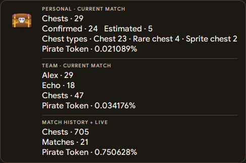

# Show the numbers on stream (OBS overlay)

The counter writes its numbers to a text file; an OBS **Text** source shows that file on your stream. You style the text
in OBS as you like. Same steps for every setup - on a dual-PC setup, do this in OBS on the streaming PC.

## On-screen overlay

Enable the on-screen overlay in **Overlay** and apply your changes. Enable **Visible when sharing your screen** to include it in Discord screen sharing. The **Transparency** slider controls its opacity, and the preview shows the current wording and statistics.

Use the global checkboxes to choose the optional statistics, then enable or disable each custom section. The floating overlay and app-managed OBS text use the same sections in this order.

| Scope | Counts and estimate |
|---|---|
| Personal | Your current match, with the selected count layout and Pirate Token estimate. |
| Team | Submitted counts for the same verified session, shown when a teammate has contributed. |
| All matches | Your local saved matches and the current counter, with linked team sessions counted once. |

Each on-screen section has its own heading and multiline content editor. You can rename the Personal, Team and All matches headings and change which values each section shows. The All matches section includes the total match count.

| Placeholder | Value |
|---|---|
| `{total}` | Chest total for the section. |
| `{certain}` | Confirmed openings. |
| `{approx}` | Additional estimated openings. |
| `{chance}` | Estimated Pirate Token percentage. |
| `{players}` | Submitted players in the verified team. |
| `{names}` | Names of the submitted players. |
| `{member_totals}` | One line per team member with their chest count for the current match. |
| `{matches}` | Match count for the cumulative section. |
| `{types}` | Available chest-type breakdown. |

For example, an All matches heading can use the content below.

```text
{total} chests across {matches} matches
Pirate Token · {chance}
```

The Personal section shows your live counter during the match. When the current saved match is verified at the lobby, the same lines show the replay’s confirmed count and chest types. The original live count remains in Compare replay. The Team section appears when a teammate has contributed to the same verified session. Its default template shows **Chests** first, followed by each member’s count and then the Pirate Token odds. The **Match history + live** section combines known matches and the current counter. The **Group leaderboard** uses results published to Discord. Use the preview to check the text before applying it. Applying the templates refreshes both the floating overlay and `chest_counter.txt`.

Use `**…**` around any part of a template to make it bold in the floating overlay and preview. For example, `Chests · **{total}**` bolds only the number. Leave a blank line between statistics to add vertical space. OBS receives the same text and spacing as plain text.

The cumulative estimate preserves the boost used in each match. For `nᵢ` chests at per-chest probability `pᵢ`, it uses `1 − ∏(1 − pᵢ)ⁿᵢ`. Solo matches use your personal counts. Verified shared sessions use received team counts once, including your own contribution. A delayed result updates that session's total.

Team totals can be partial while a player's app or the bot is disconnected. No teammate count is invented. See [live sharing](matches-and-discord.md#live-sessions-and-history).



## Add the Text source

1. Open the scene your **viewers** see (not `ChestDetectorFeed`).
2. **Sources** -> **+** -> **Text (GDI+)** -> name it -> OK.
3. Tick **Read from file**, click **Browse** and choose **`obs_output\chest_counter.txt`** in the app's folder. The app's
   **Overlay** page shows the exact path; **Copy path** puts it on the clipboard.
4. Choose font, size and colour -> OK.

That is the only file you ever point OBS at. The counter rewrites it the moment a chest is counted; OBS re-reads the file
about once a second, so the text on stream changes within about one to two seconds. For instant updates, see
[OBS WebSocket](#instant-updates-obs-websocket-optional) below.

## Choose what viewers see

The app's **Overlay** page uses the same enabled section headings and content for its preview, floating window and OBS text. Configure each section with its multiline template, use the global statistic checkboxes for optional values and click **Apply**. There is one main text output path, so changing the section layout keeps the same OBS source.

The text file carries the section headings and lines. Set its font, size and colour in OBS. The floating overlay adds the animated chest, opacity and Windows capture visibility options.

Legacy CLI formats and separate `certain_chests.txt` and `approximate_chests.txt` files are retained for existing terminal workflows and separately styled sources. They use the original convention where the approximate figure includes confirmed openings.

## Instant updates: OBS WebSocket (optional)

Instead of OBS reading the file, the app can put the same text straight into your Text source through OBS's built-in
WebSocket server (OBS 28 or newer). Updates show at once, and the source needs no file path. The text file is still
written either way - nothing else changes.

1. In OBS: **Tools > WebSocket Server Settings** > tick **Enable WebSocket server** (port **4455**). Leave
   **Enable Authentication** on and click **Show Connect Info** to see the password.
2. In the app: **Overlay** page > **OBS WebSocket** > tick **Update a Text source in OBS directly**, paste the password,
   click **Connect**.
3. Pick your **Text source** in the list (Refresh lists them). Use a Text source **without** "Read from file" - or, if it
   reads the file, click **Use direct updates** (the app never changes that setting by itself).

The status line says what is happening: *Connected* (updating), *Waiting for OBS* (OBS closed - the app keeps trying and
catches up with the current numbers when OBS is back), *Password problem*, and so on. A renamed source is followed
automatically; a deleted one is reported.

- **Password:** kept in Windows Credential Manager, never in `config.toml`, a log or the diagnostics report.
  **Forget password** removes it.
- **What the app may do in OBS:** it only lists inputs, reads one source's settings and sets that source's text. It
  cannot start or stop your stream, change scenes or anything else.
- **OBS on another PC:** enter that PC's IPv4 address instead of `127.0.0.1` and allow TCP port 4455 in its firewall.
- **Do not let two tools update the same Text source** (for example an older counter script and this app): the last one
  wins and the text flickers. Give each tool its own source.

## Advanced configuration and output files

The OBS WebSocket settings are in `[obs_websocket]` (`enabled`, `host`, `port`, `source`, `source_uuid`).

The app saves shared templates in `[display]`. `use_custom_sections` enables the current section output. Each scope has an enabled flag, title and multiline template, for example `screen_personal_enabled`, `screen_personal_title` and `screen_personal_template`. Team and cumulative scopes use the same key pattern. `screen_opacity` stores the floating-window opacity.

Legacy CLI wording remains available through `show`, `both_layout`, `certain_text`, `approx_text` and `combined_status_format`. Those values support `{count}`, `{certain}`, `{approx}` or `{approximate}`, plus escaped braces. They apply to the legacy output path when custom sections are disabled.

For separately styled sources the counter also writes:

| File in `obs_output\` | Contains |
|---|---|
| `chest_counter.txt` | **the one to use:** whatever the Overlay page chose |
| `chest_status.txt` | legacy: one line with both numbers (or the single number chosen) |
| `certain_chests.txt` | always the confirmed number |
| `approximate_chests.txt` | always the estimated total |
| `last_chest.txt` | the most recent chest, e.g. `CHEST +1 • HIGH` |

Opening the app writes your saved numbers back into these files, so the overlay is right before you start counting.
