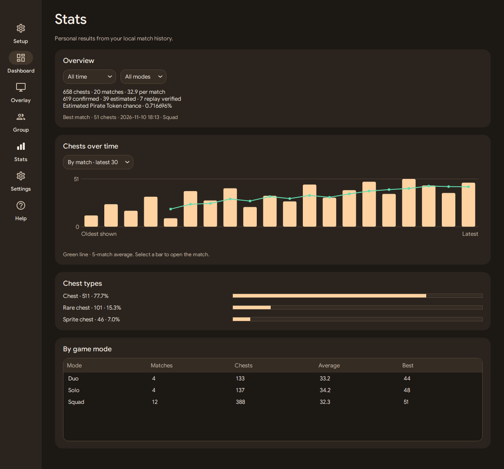

# Personal stats

Open **Stats** in the navigation rail. Choose a period and a game mode to filter the totals, record, graphs and mode table. The 7-day and 30-day filters include today.

- **Overview** shows saved matches, chests, confirmed and estimated counts, average, record and how many matches were replay verified.
- **Chests over time** groups by date or displays the last 30 matches within the current filters. In the per-match view, the green line starts after five matches and averages the current match and the four previous matches in the filtered history. Hover to read a bar. Click a match bar or use the arrow keys and Enter to open its result and the live-to-replay difference when available.
- **Chest types** shows counts and shares. Older records with missing type data contribute to **Not classified**.
- **By game mode** shows matches, total chests, average and best match for each mode in the selection.

The estimated Pirate Token chance combines the saved counts using each match's boost. A verified replay replaces that match's live counts. The page uses local saved matches. On Discord, [`/stats`](matches-and-discord.md#commands) uses finished results shared to the group.

