# App previews

These are captures of the application using sample data. Click an image to view it at full resolution.

## Setup

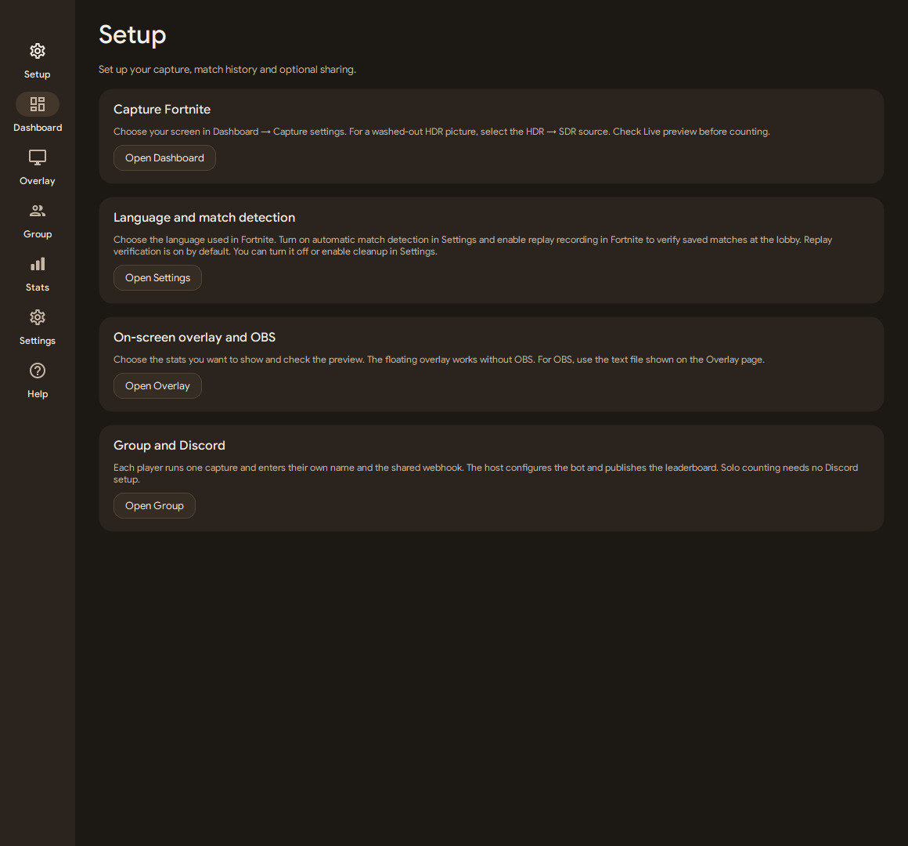

## Dashboard

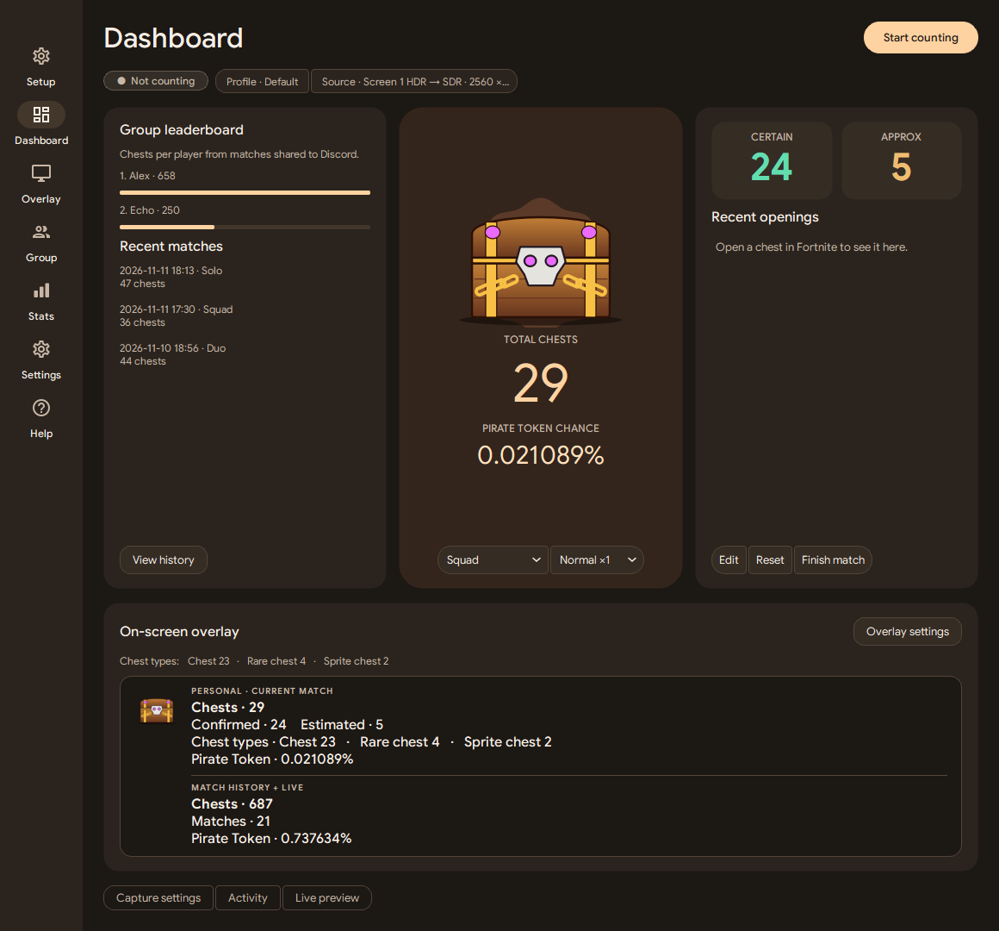

## Personal stats

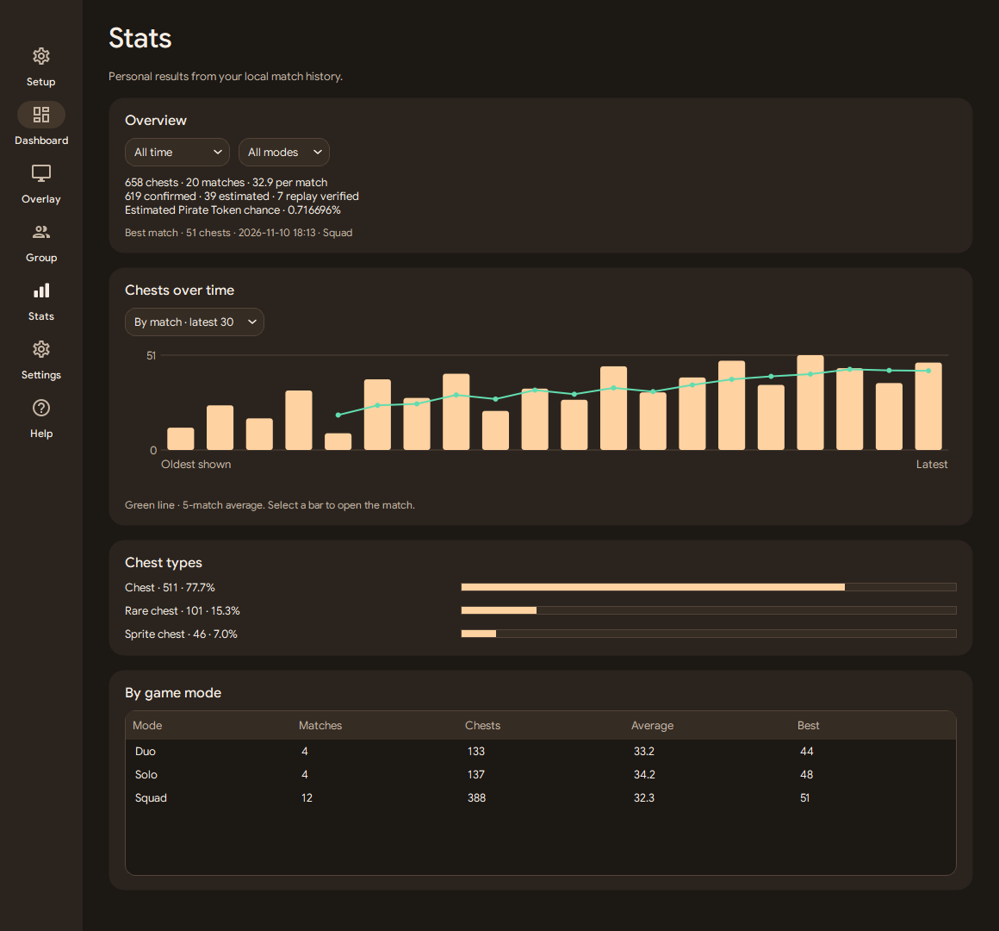

## Group and match history

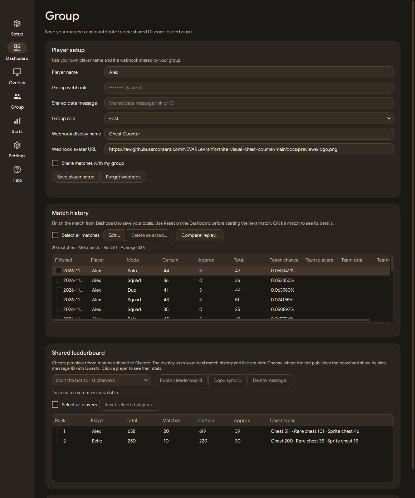

## Overlay settings

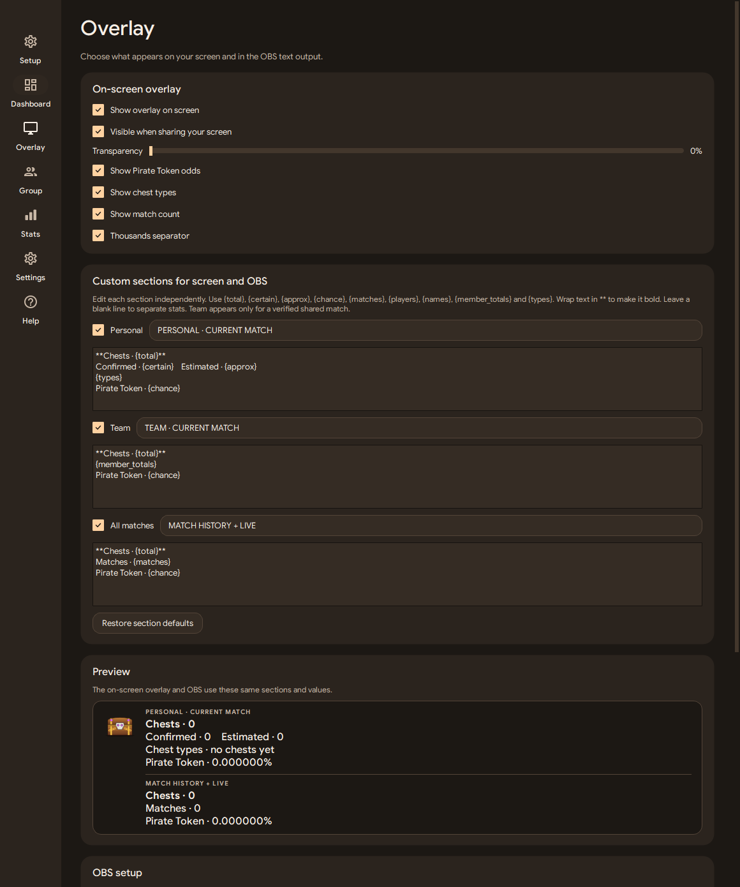

## Floating overlay

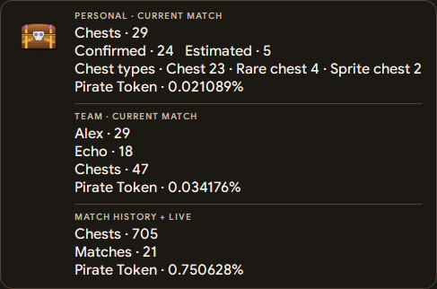

## Settings

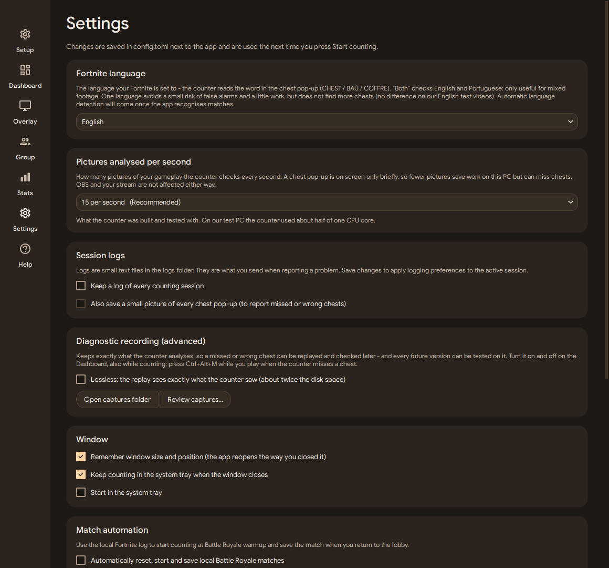

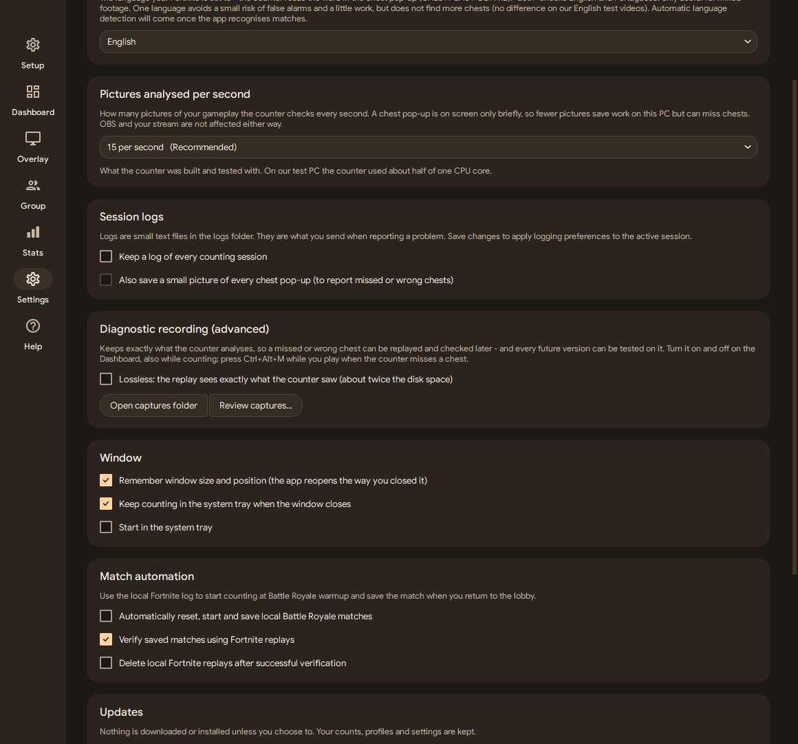

## Discord simulations

These are local renderings with sample data. The leaderboard uses the bot’s public embed payload and shows the synchronized total before the player ranking. The match history preview uses the same sample totals.

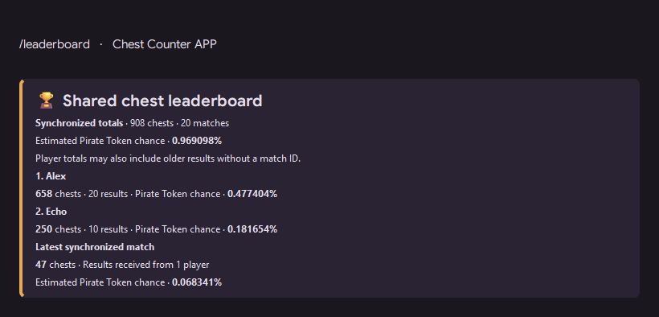

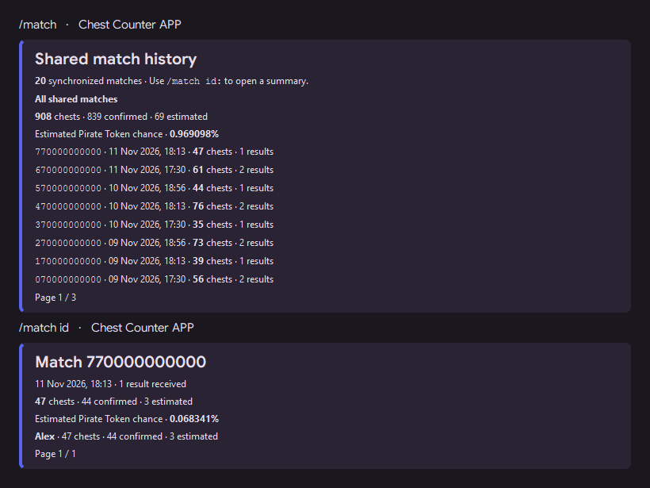

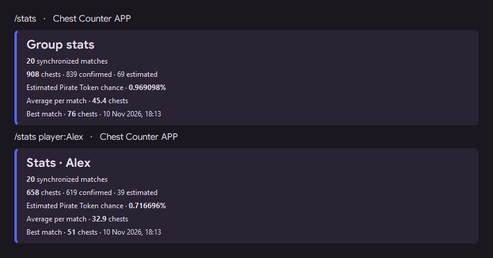

## Artwork

The logo and banner reuse the app's chest illustration. See [acknowledgements](../ACKNOWLEDGEMENTS.md).

